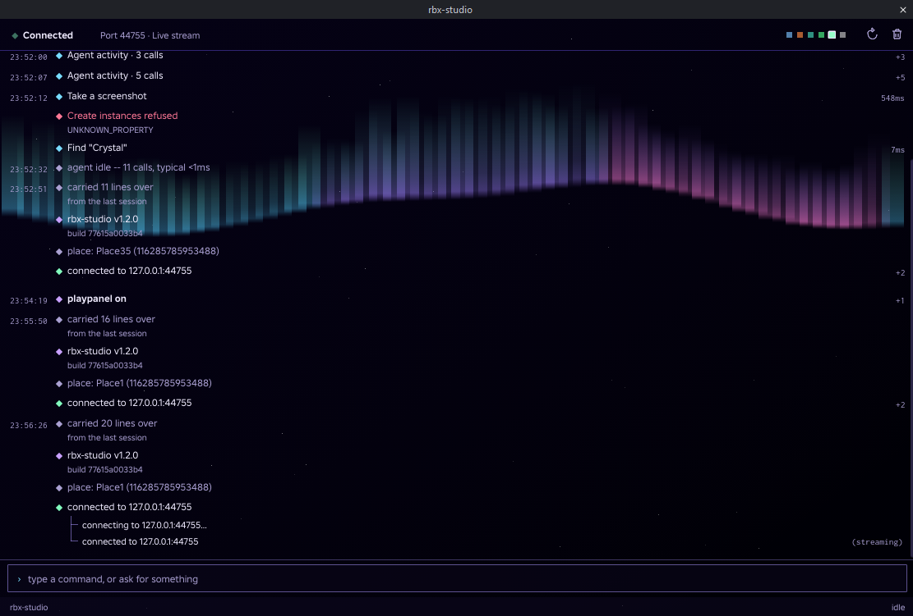

# Roblox Studio MCP

Let an AI agent drive Roblox Studio: read your place, edit scripts, build geometry, run playtests, take screenshots. 35 tools.



## Install

Runs on Windows (x64, ARM) and macOS (Apple silicon, Intel). The server is a native binary that npm picks for your platform; `npx` needs Node 18 or newer.

**1. The plugin**

```bash
npx -y @el4cteo/rbx-studio-mcp --install-plugin
```

Or drop `StudioMCP.rbxmx` from [Releases](https://github.com/EL4CTEO/rbx-studio-mcp/releases) into your Studio plugins folder.

**2. The server**

```bash
claude mcp add rbx-studio -- npx -y @el4cteo/rbx-studio-mcp
```

<details>
<summary>Other clients</summary>

Codex CLI:

```bash
codex mcp add rbx-studio -- npx -y @el4cteo/rbx-studio-mcp
```

Cursor, Claude Desktop, Gemini CLI, Windsurf:

```json
{
  "mcpServers": {
    "rbx-studio": {
      "command": "npx",
      "args": ["-y", "@el4cteo/rbx-studio-mcp"]
    }
  }
}
```

VS Code / Copilot (`.vscode/mcp.json`) uses `"servers"` instead of `"mcpServers"`, plus `"type": "stdio"`.

opencode (`opencode.json`):

```json
{
  "mcp": {
    "rbx-studio": {
      "type": "local",
      "command": ["npx", "-y", "@el4cteo/rbx-studio-mcp"],
      "enabled": true
    }
  }
}
```

DeepSeek Harness: see [`config/dsh.cordis.yml`](config/dsh.cordis.yml). Needs `DEEPSEEK_API_KEY`.
</details>

**3.** Open Studio and accept the `127.0.0.1` prompt. Check it works with `studio_status`.

Something wrong? Run `npx -y @el4cteo/rbx-studio-mcp doctor`. It says what is broken and how to fix it.

The port is **44755**. Change it with `--port` and match it in the plugin.

## Tools

| | |
|---|---|
| **Session** | `studio_status` `list_studios` `set_active_studio` |
| **Discover** | `tree` `inspect` `find` `api` |
| **Scripts** | `script_read` `script_edit` `script_grep` `script_create` `sync` |
| **Instances** | `create` `modify` `delete` `move` |
| **World** | `geometry` `terrain` `generate` `assets` `collision` `audio` `undo` |
| **Data & live game** | `datastore` `universe` |
| **Run & debug** | `playtest` `execute_luau` `character` `input` `console` `debug` `performance` |
| **Look** | `screenshot` `viewport` `device` |

Write tools take arrays: ten script edits is one call and one **Ctrl+Z**, and either all apply or none do.

`device` emulation stays on until `device op="stop"`.

## Why this one

- **Fast:** the bridge pushes calls instead of polling, 13.6 ms per call against 25.8 ms.
- **Safe script edits:** writes go through the script editor, so unsaved work survives.
- **Stale edits are refused:** line-range and whole-file edits need the `rev` from `script_read`.
- **Property names are checked** against the running engine, so `Anchorred` comes back as a suggestion, not a runtime error.

## Debug a playtest

A playtest connects a second session, so pass its `studioId`. Use the edit session for changes that must last.

Readers can run in the player's own client with `target="client"` (add `player="Name"` with several players):

```
tree target="client" path="Players.Alice.PlayerGui" handles=true
find target="client" className="TextButton"
viewport op="pick" x=0.5 y=0.5 target="client"
debug op="watch" path=... target="client" properties=["Text"] seconds=5
```

- **Handles** (`handles=true`) replace paths. They survive renames and moves, and fail once the object is deleted or expired.
- **`viewport op="uisnap"`** snapshots a UI. Call it again with `compareTo="<id>"` to see what changed.
- **`debug op="collisions"`** reports what a part or model hit, hardest first.
- **`performance op="microprofile"`** ranks the engine scopes that filled your frames. Uses Roblox's [LibMP](https://github.com/Roblox/libmp) (MIT).
- **`collision op="cast"`** sweeps rays, blocks, spheres or a real part.
- **Clipped `execute_luau` results** return a `resultId`. Page through it for 120 seconds without rerunning.

## Work on files

`sync` mirrors your scripts into a folder, so an agent can edit code with its own file tools and use Studio to test.

```
sync op="pull"      # Studio -> ./studio
sync op="push"      # ./studio -> Studio
sync op="watch"     # both ways, live, until op="stop"
```

- **Layout:** Rojo-style (`Main.server.luau`, `.client.luau`, `.luau`), plus a `sourcemap.json` for luau-lsp.
- **Renames:** rename or move a file and the script moves with it.
- **Conflicts:** edited on both sides means neither is touched. Studio's version waits in `.rbx-sync/conflicts/`. Merge it and sync again, or pass `prefer: "studio"` or `"disk"`.
- **Deletes:** deleting a file deletes the script (one Ctrl+Z). A script deleted in Studio sends its file to `.rbx-sync/trash`.
- **UI as files:** `export` writes an instance tree as a `.build.json` file, and `build` rebuilds it.

## Open Cloud

Some calls reach past Studio to Roblox itself and need an API key. Everything else works without one.

| | |
|---|---|
| `assets op="upload"` | send a local audio, image, model or video file, get an asset id |
| `datastore target="live"` | the running game's real player data |
| `execute_luau target="live"` | run a script on the published place |
| `universe` | restart servers, message them, ban players, read logs and analytics, sell products and passes, schedule events |
| also | `assets op="grant"`, `op="publish"`, `script_read`/`script_edit target="live"` |

Make a key at [Creator Dashboard → Credentials](https://create.roblox.com/dashboard/credentials), then in the Studio panel:

```
cloud key <paste>
cloud user <your user id>
cloud place <place id>
```

<details>
<summary>Key permissions</summary>

Add the ones you want: `assets`, `universe-datastores`, `ordered-data-stores`, `luau-execution-sessions`, `universe-places`, `universe-place-instances`, `universe`, `messaging-service`, `user-restrictions`, `inventory`, `users`, `asset-permissions`, `developer-products`, `game-passes`, `universe-analytics`. Scheduling events needs `universe.event:read` and `:write`.
</details>

The key is stored at `~/.rbx-studio-mcp/credentials.json`, never in the place file or the conversation. `cloud` shows what is set, `cloud test` re-checks it, `cloud forget` deletes it. `ROBLOX_API_KEY` and friends in the environment take priority.

**Per-game permissions.** Agents can only read a game's settings until you allow more. Type `allow` in the panel to see the list for the open game, `allow <group>` to turn one on, `allow <group> off` to turn it off. Groups: `read`, `assets`, `data`, `edit` (settings, publishing, restarts, live Luau), `money` (products and passes), `players` (bans).

## The console panel

Every call is logged with how long it took. At the foot of the panel is a command line: click it to see every command, or type `help`.

Six themes with animated backgrounds: Nebula, Ember, Tide, Galaxy, Aurora and Monolith. Pick one from the dots in the header or with `theme <name>`; `background off` turns the animation off.

Run `chat on` and sentences you type go to a real coding agent. It uses any of 31 supported agents on your PATH, like Claude Code, Codex or Gemini; `agent` lists them and `agent use <id>` picks one. It runs separately from your terminal and is billed separately. Claude Code and Copilot are limited to the `rbx-studio` tools; the others use their own permission settings. The **stop** button cancels it.

Run `playpanel on` to also show the panel during playtests (off by default). `playpanel left`, `right` or `bottom` docks it there; `playpanel float` floats it at the panel's size.

## Security

The server only listens on loopback. Requests need a header a browser cannot set cross-origin and a loopback `Host`, so a web page cannot reach it, even through DNS rebinding. Your experience's "Allow HTTP Requests" setting is untouched.

## Development

The server is Rust (`server/`, toolchain pinned to 1.99.1); the plugin is Luau (`plugin/`).

```bash
cargo build --release --manifest-path server/Cargo.toml
node scripts/install-plugin.mjs   # build the plugin and copy it into Studio
cargo test --manifest-path server/Cargo.toml
node scripts/test-native.mjs      # black-box MCP and bridge tests
```

The plugin checks need `luau`, `luau-compile` and `luau-analyze` from [the Luau releases](https://github.com/luau-lang/luau/releases) on `PATH` or in `tools/`.

Live tests need Studio open with the plugin loaded, and they clean up after themselves: `scripts/test-live.mjs`, `test-live-tools.mjs [--playtest]`, `test-live-sync.mjs` and `test-live-sync-scale.mjs`.

## Shoutout

Thanks to [GameDevTool](https://gamedevtool.com/ai-tools-for-roblox-studio/rbx-studio-mcp) for featuring this project in their roundup of free AI tools for Roblox Studio.

## Licence

MIT.
