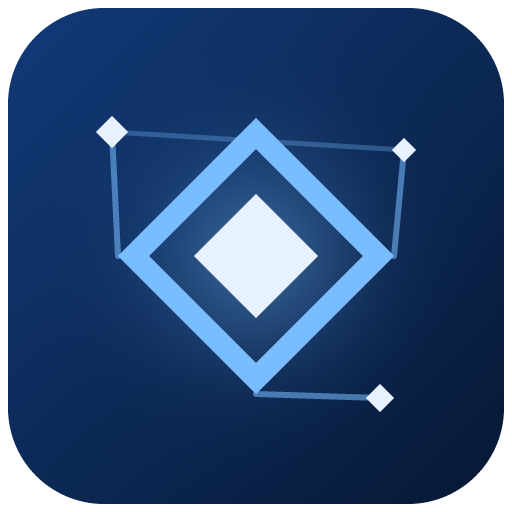
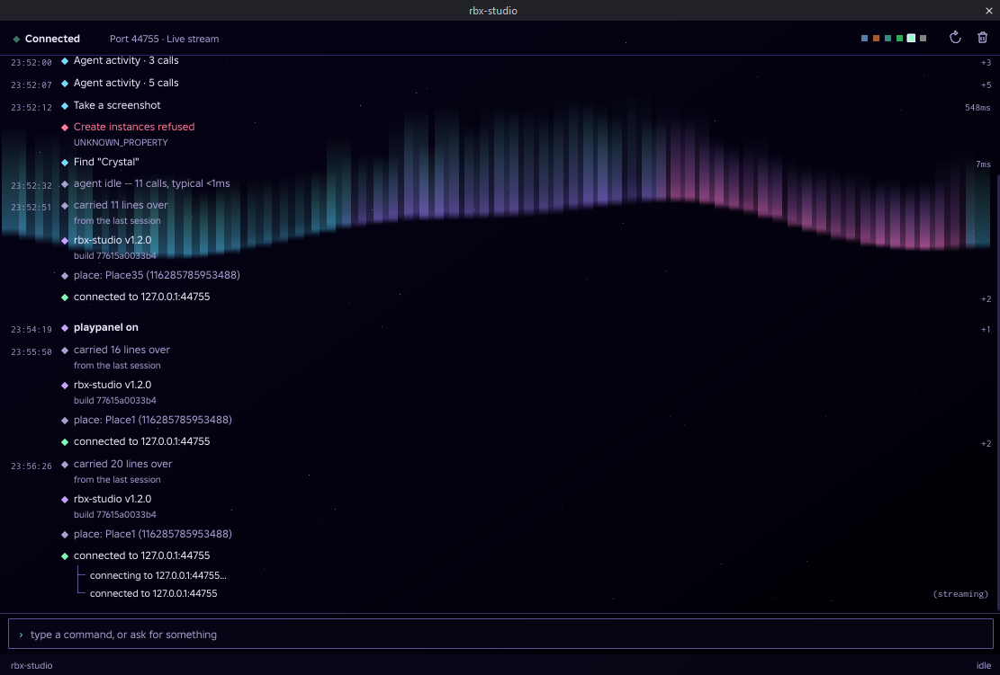

<p align="center"></p>

<h1 align="center">Roblox Studio MCP</h1>

<p align="center">
  <a href="https://www.npmjs.com/package/@el4cteo/rbx-studio-mcp"></a>
  <a href="https://crates.io/crates/rbx-studio-mcp"></a>
  <a href="https://github.com/EL4CTEO/rbx-studio-mcp/blob/main/LICENSE"></a>
</p>

Free, open-source MCP server that lets an AI agent drive Roblox Studio: read your place, edit scripts, build, playtest, take screenshots. 35 tools, plus a console panel that can run coding agents inside Studio.



## Install

Windows (x64, ARM) and macOS (Apple silicon, Intel). Native binary picked by npm; `npx` needs Node 18+.

**1. The plugin**

```bash
npx -y @el4cteo/rbx-studio-mcp --install-plugin
```

Or drop `StudioMCP.rbxmx` from [Releases](https://github.com/EL4CTEO/rbx-studio-mcp/releases) into your Studio plugins folder.

**2. The server**

```bash
claude mcp add rbx-studio -- npx -y @el4cteo/rbx-studio-mcp
```

<details>
<summary>Other clients</summary>

Codex CLI:

```bash
codex mcp add rbx-studio -- npx -y @el4cteo/rbx-studio-mcp
```

Cursor, Claude Desktop, Gemini CLI, Windsurf:

```json
{
  "mcpServers": {
    "rbx-studio": {
      "command": "npx",
      "args": ["-y", "@el4cteo/rbx-studio-mcp"]
    }
  }
}
```

VS Code / Copilot (`.vscode/mcp.json`) uses `"servers"` instead of `"mcpServers"`, plus `"type": "stdio"`.

opencode (`opencode.json`):

```json
{
  "mcp": {
    "rbx-studio": {
      "type": "local",
      "command": ["npx", "-y", "@el4cteo/rbx-studio-mcp"],
      "enabled": true
    }
  }
}
```

DeepSeek Harness: see [`config/dsh.cordis.yml`](config/dsh.cordis.yml). Needs `DEEPSEEK_API_KEY`.
</details>

**3.** Open Studio, accept the `127.0.0.1` prompt, then check with `studio_status`.

Problems? `npx -y @el4cteo/rbx-studio-mcp doctor` says what's broken and how to fix it. Port **44755** (`--port` to change; match it in the plugin).

## Tools

| | |
|---|---|
| **Session** | `studio_status` `list_studios` `set_active_studio` |
| **Discover** | `tree` `inspect` `find` `api` |
| **Scripts** | `script_read` `script_edit` `script_grep` `script_create` `sync` |
| **Instances** | `create` `modify` `delete` `move` |
| **World** | `geometry` `terrain` `generate` `assets` `collision` `audio` `undo` |
| **Data & live game** | `datastore` `universe` |
| **Run & debug** | `playtest` `execute_luau` `character` `input` `console` `debug` `performance` |
| **Look** | `screenshot` `viewport` `device` |

- Write tools take arrays: ten edits = one call, one **Ctrl+Z**, all or nothing.
- `screenshot frames=6` returns a timed contact sheet to check motion.
- `inspect format="studio-json"` / `create json=` / `modify json=` speak Studio's Copy-as-JSON format.
- `device` emulation stays on until `device op="stop"`.

## Why this one

- **Fast:** push-based bridge, 13.6 ms per call vs 25.8 ms polling.
- **Safe script edits:** writes go through the script editor, so unsaved work survives; stale edits (wrong `rev`) are refused.
- **Checked properties:** names are validated against the engine, so `Anchorred` gets a suggestion instead of a runtime error.

## Debug a playtest

A playtest is a second session: pass its `studioId` (use the edit session for lasting changes). Readers can run in the player's client with `target="client"` (`player="Name"` with several players):

```
tree target="client" path="Players.Alice.PlayerGui" handles=true
find target="client" className="TextButton"
viewport op="pick" x=0.5 y=0.5 target="client"
debug op="watch" path=... target="client" properties=["Text"] seconds=5
```

- **Handles** (`handles=true`) survive renames and moves.
- **`viewport op="uisnap"`** snapshots UI; `compareTo="<id>"` diffs it.
- **`debug op="collisions"`** lists what a part hit, hardest first.
- **`performance op="microprofile"`** ranks engine scopes per frame ([LibMP](https://github.com/Roblox/libmp)).
- **`collision op="cast"`** sweeps rays, blocks, spheres or a real part.
- Clipped `execute_luau` output returns a `resultId` you can page for 120 s.

## Work on files

`sync` mirrors your scripts into a folder, so an agent can edit code with its own file tools and use Studio to test.

```
sync op="pull"      # Studio -> ./studio
sync op="push"      # ./studio -> Studio
sync op="watch"     # both ways, live, until op="stop"
```

- Rojo-style layout (`.server.luau`, `.client.luau`, `.luau`) + `sourcemap.json` for luau-lsp.
- Renames and moves follow the script; deletes are one Ctrl+Z (Studio-side deletes go to `.rbx-sync/trash`).
- Conflicts are never overwritten: Studio's copy waits in `.rbx-sync/conflicts/`, or pass `prefer: "studio"|"disk"`.
- `export` / `build` turn an instance tree (e.g. UI) into a `.build.json` file and back.
- Pushes are checked with [luau-lsp](https://github.com/JohnnyMorganz/luau-lsp/releases) if on `PATH`: syntax errors are held back, type errors reported. `op="check"` checks only.

## Open Cloud

Optional. These calls reach Roblox itself and need an API key:

| | |
|---|---|
| `assets op="upload"` | send a local audio, image, model or video file, get an asset id |
| `datastore target="live"` | the running game's real player data |
| `execute_luau target="live"` | run a script on the published place |
| `universe` | restart servers, message them, ban players, read logs and analytics, sell products and passes, schedule events |
| also | `assets op="grant"`, `op="publish"`, `script_read`/`script_edit target="live"` |

Make a key at [Creator Dashboard → Credentials](https://create.roblox.com/dashboard/credentials), then in the Studio panel:

```
cloud key <paste>
cloud user <your user id>
cloud place <place id>
```

<details>
<summary>Key permissions</summary>

Add the ones you want: `assets`, `universe-datastores`, `ordered-data-stores`, `luau-execution-sessions`, `universe-places`, `universe-place-instances`, `universe`, `messaging-service`, `user-restrictions`, `inventory`, `users`, `asset-permissions`, `developer-products`, `game-passes`, `universe-analytics`. Scheduling events needs `universe.event:read` and `:write`.
</details>

The key lives in `~/.rbx-studio-mcp/credentials.json`, never in the place or the chat (`cloud` / `cloud test` / `cloud forget`; `ROBLOX_API_KEY` env wins).

**Per-game permissions:** agents can only read a game's settings until you type `allow <group>` in the panel (`allow` lists them, `allow <group> off` revokes). Groups: `read`, `assets`, `data`, `edit`, `money`, `players`.

## The console panel

Every call is logged with its duration. The command line at the bottom takes `help`.

- **Themes:** Nebula, Ember, Tide, Galaxy, Aurora, Monolith (`theme <name>`, `background off`).
- **Agents in Studio:** `chat on` sends what you type to a coding agent on your PATH (31 supported: Claude Code, Codex, Gemini…). `agent` lists them, `agent use <id>` picks one. Billed by that agent; **stop** cancels.
- **Playtests:** `playpanel on` shows the panel during playtests (`left`, `right`, `bottom`, `float`).

## Security

Loopback only. Requests need a header browsers can't set cross-origin and a loopback `Host`, so web pages can't reach it (DNS rebinding included). "Allow HTTP Requests" is untouched.

## Development

The server is Rust (`server/`, toolchain pinned to 1.100.0); the plugin is Luau (`plugin/`).

```bash
cargo build --release --manifest-path server/Cargo.toml
node scripts/install-plugin.mjs   # build the plugin and copy it into Studio
cargo test --manifest-path server/Cargo.toml
node scripts/test-native.mjs      # black-box MCP and bridge tests
```

Plugin checks need `luau`, `luau-compile`, `luau-analyze` ([Luau releases](https://github.com/luau-lang/luau/releases)) on `PATH` or in `tools/`. Live tests (`scripts/test-live*.mjs`) need Studio open with the plugin.

## Shoutout

Thanks to [GameDevTool](https://gamedevtool.com/ai-tools-for-roblox-studio/rbx-studio-mcp) for featuring this project.

## License

MIT
